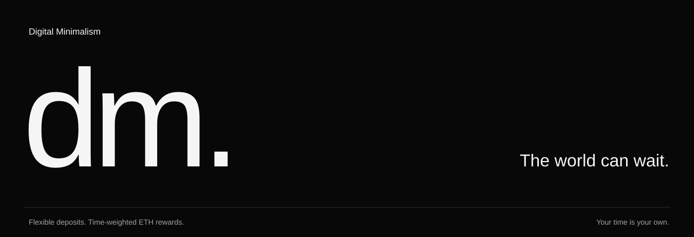
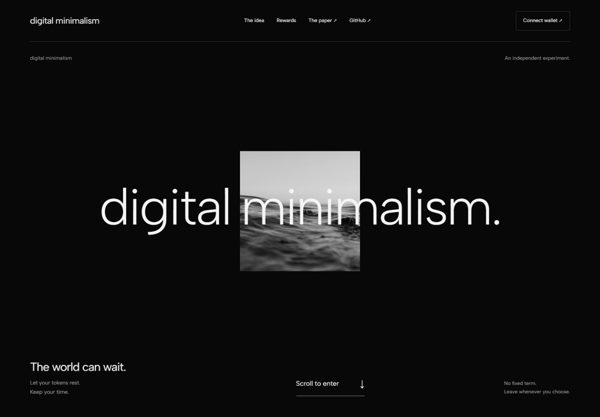
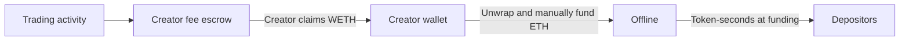

# digital minimalism



<p align="center">
  <a href="https://github.com/DigitalMinimalism0/DM-Digital-Minimalism/actions/workflows/ci.yml"></a>
  <a href="LICENSE"></a>
  <a href="docs/README.zh-CN.md">中文说明</a> · <a href="docs/ACCOUNTING.md">The mathematics</a> · <a href="LAUNCH.md">Launch guide</a> · <a href="SECURITY.md">Security</a>
</p>

**Let your tokens rest. Keep your time.**

digital minimalism is an independent experiment in digital minimalism. Set aside some tokens, share ETH that is actually funded, and return whenever you choose. No fixed term. No exit fee. No check-ins.

Inspired by [Vitalik Buterin’s _Digital minimalism_](https://vitalik.eth.limo/general/2026/10/31/digital_minimalism.html). Independent; not affiliated with or endorsed by Vitalik Buterin or Stockereum.



## One small mechanism

1. **Go offline.** Deposit an amount of DM you choose.
2. **Give it time.** Each token accumulates time weight while it rests.
3. **Return on your terms.** Collect ETH without resetting time. Withdraw any amount whenever you want; already earned ETH stays yours.

At each funding, a current deposit’s share is its **token-seconds / all current token-seconds**. Adding tokens gives the added amount zero age. Partial withdrawal removes proportional age. Full withdrawal removes active age; re-entry starts fresh. Time is uncapped, so old positions can carry substantially more weight.

Rewards are discrete allocations of received ETH. **No funding means no new rewards.** This is fee redistribution, not a source of yield generated by inactivity. Offline does not prove that a person has disconnected from the internet.

## Where ETH comes from

Stockereum’s normal 3% trade fee splits into **1% platform + 2% creator**. The creator manually claims their share as WETH, unwraps it, and funds Offline with ETH. The launch’s native Holder Rewards option is OFF. Funding is not automatic or guaranteed; the platform’s initial anti-snipe window temporarily charges a higher fee. [Platform documentation](https://stockereum.com/docs).



## An interface you can put down

A native scroll entrance expands the ocean photograph into the newer photographic halftone background. The preceding section layout opens directly into a dark reading surface with ordinary forms: deposit, withdraw, collect. Texture stays outside the text surface. Exact-amount approvals, transaction review, a consistent-block rewards leaderboard, funding records and an administrator launch panel. No terminal or end-user CLI. Albert Sans, image and scripts are served locally; no analytics or tracking cookies.

The project name is **digital minimalism** (lowercase); its token is **DM** (uppercase). The logo is a provisional typographic mark while final brand assets are prepared. The code builds into an honest pre-launch state until a new deployment manifest is published. No legacy deployment is connected.

## Run locally

Node 22+, pnpm 10 and [Foundry](https://getfoundry.sh) are required.

```powershell
git clone --recurse-submodules https://github.com/DigitalMinimalism0/DM-Digital-Minimalism.git
cd DM-Digital-Minimalism
pnpm install --frozen-lockfile
forge build
pnpm dev
```

Open the local URL printed by the server. `/admin` is the administrator route; access is checked against on-chain roles.

## Verify the work

```powershell
pnpm test
pnpm build
pnpm test:e2e
pnpm preflight:mainnet
```

`test:e2e` uses a fresh local Anvil chain and browser wallet fixture, never a mainnet signer. Mainnet-fork integration is a separate read-only rehearsal: `pnpm test:fork`. See [TESTING.md](TESTING.md) for exact coverage and limitations.

## Launch last

Prepare and verify the companion contract and website first. Launch the token on Stockereum only after everything is ready. Connect the original creator wallet to `/admin`, paste the CA, review and sign the one-time binding. No frontend source edit or second contract binding is needed.

[The complete PowerShell launch guide →](LAUNCH.md)

## Read the source

| Path                        | Purpose                                                                                 |
| --------------------------- | --------------------------------------------------------------------------------------- |
| `contracts/src/Offline.sol` | Flexible principal custody, two-index token-seconds rewards, one-time launch validation |
| `contracts/test/`           | Unit, fuzz, state invariants and platform fork integration                              |
| `core/offline.js`           | ABI, ranking and user-facing error descriptions                                         |
| `web/`                      | Public site, administrator panel and paper                                              |
| `scripts/`                  | Build, local rehearsal, read-only checks and owner-run deployment                       |
| `docs/ACCOUNTING.md`        | Formula, examples and rounding model                                                    |
| `config.json`               | Public addresses and settings; contains no keys                                         |

The administrator can pause **new deposits only** and transfer the role through two-step acceptance. They cannot take user funds, add withdrawal conditions, change the reward formula or upgrade the contract. Source publication and automated testing are not an independent audit.

## Sources & credits

- [Digital minimalism, Vitalik Buterin, 31 October 2026](https://vitalik.eth.limo/general/2026/10/31/digital_minimalism.html).
- [Stockereum official documentation](https://stockereum.com/docs); [integration verification](docs/STOCKEREUM.md).
- Albert Sans (active), Manrope and IBM Plex fonts: SIL Open Font License, license files in `web/fonts/`.
- [Ocean image on Unsplash](https://images.unsplash.com/photo-1518837695005-2083093ee35b), stored locally with monochrome treatment.
- Code: [MIT](LICENSE). Maintained under [DigitalMinimalism0](https://github.com/DigitalMinimalism0).
